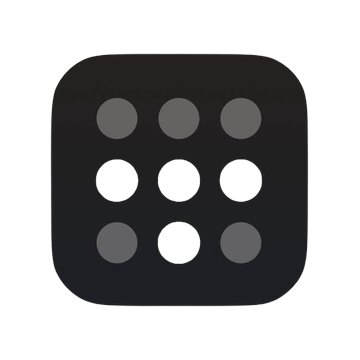

<p align="center">
  
</p>

<div align="center">

# TailscaleForWP

**A Tailscale client for Windows Phone 8.1.** It speaks the real Tailscale control
protocol (ts2021, Noise IK) from a 2014 phone that has only .NET 4.5 and the WP8.1
reference profile.

[The proof](#the-proof-that-matters) · [Build and verify](#build-and-verify) · [Use it](#use-it) · [Troubleshooting](#troubleshooting) · [Italiano](#italiano)


</div>

TailscaleForWP is one WP8.1 app and one portable engine written in C# 5, built by
reading the pinned Tailscale source instead of from memory. There is no server of
mine in the picture: the control plane it talks to is the real Tailscale one. On
2026-10-11 the app ran on a real Lumia and came back with the netmap of a real
tailnet. What it does not do yet is move traffic: the data plane is still to be
written.

## Status

- **Good for:** getting a real tailnet's control plane onto a Windows Phone 8.1
  device: sign-in, registration, the netmap, and a log that survives the app.
- **Not for:** moving traffic. There is no data plane yet (no WireGuard, no proxy),
  so nothing on the phone reaches a peer through it today.

| Part | State | How it is checked |
|---|---|---|
| Crypto (X25519, ChaCha20-Poly1305, BLAKE2s, SHA-256, HKDF, NaCl box) | done | RFC 7748 / 8439 / 7693 / 5869 vectors and independent TweetNaCl vectors |
| Noise IK handshake, ts2021 dialer, HTTP upgrade | done | `Tailscale.Cli handshake` against `controlplane.tailscale.com` |
| Registration, netmap, sign-in URL | works on a real device | in-memory tests for the state machine, and a phone run on 2026-10-11; the first sign-in still needs a person at the browser |
| App UI (sign-in, device list, log) | done in code | every visible string checked by `tools/check-ui-resources.py`; acceptance on a phone is still manual |
| Phone log (`LocalFolder\registro.log`) | done | pulled off a real phone with `ISETool.exe` on 2026-10-11 |
| Localized en-US and it-IT | done | `tools/check-ui-resources.py` checks both languages |
| Data plane (WireGuard, proxy) | not started | nothing yet |

What "works" means here, from that real run: the log pulled off the phone shows the
ts2021 handshake, `/machine/register -> 200`, and the state going
`Connecting -> Authorized`. Stopping the app on purpose produced the `0x800703E3`
abort, the client recognised it, and the engine came back with the same node key, so
the tailnet kept seeing one device. That run also found a bug no test could see: the
page opened on a black screen, because the first paint read the device name before
the engine had written it. It is fixed (`Tailscale/Services/EngineService.cs` never
returns a null device name), and a crash on the UI thread now leaves a line in the
log instead of taking the app down in silence.

## The proof that matters

```
src\Tailscale.Cli\bin\Release\Tailscale.Cli.exe handshake
server key ts2021=mkey:7d2792f9c98d753d2042471536801949104c247f95eac770f8fb321595e2173b
            legacy=mkey:9e5156a4c65121306dd2d8ed8f92cb8d738e2533011344b522c5d28409bc4970
ts2021: upgrade accettato su http://controlplane.tailscale.com:80
handshake ok, peer=mkey:7d2792f9c98d753d2042471536801949104c247f95eac770f8fb321595e2173b
handshake hash=4754800d5370c4209dde12d541b20b85528d6787e1fbb13bd666d21693d0c973
versione del protocollo=148
```

This is not a round-trip with itself. The real server accepts our 101-byte message 1
and answers with a message whose tag verifies against the public key it publishes at
`/key`. If the transcription of Noise IK, HKDF-BLAKE2s, X25519 or ChaCha20-Poly1305
were wrong by one byte, that tag would not verify.

## Build and verify

On a Windows PC you need MSBuild 12.0 (VS2013), the Windows Phone 8.1 SDK and
Python 3. No NuGet, no dotnet, no Go.

```
tools\check-all.cmd
```

It checks the protocol pin, the UI strings and the agent skills first, then builds
the desktop core, runs the tests, runs the CLI offline selftest and builds the ARM
package of the app. The first problem stops it. When everything is fine the last
line is `CHECK-ALL OK`.

The ARM build is not decoration. It is the check that found every platform limit of
this project: WP8.1 has no `System.Security.Cryptography`, no `System.Net.Sockets`,
no `Encoding.ASCII`, and `HttpWebRequest` only works asynchronously. That is why the
core takes `IRandomSource`, `IStreamConnector`, `IHttpFetcher` and `Sleep` as injected
dependencies instead of calling an API directly.

## Use it

**On the PC.** The CLI is where the protocol meets the real server:

```
src\Tailscale.Cli\bin\Release\Tailscale.Cli.exe handshake   # Noise IK handshake against the real control server
src\Tailscale.Cli\bin\Release\Tailscale.Cli.exe probe       # HTTP/2 diagnostics
src\Tailscale.Cli\bin\Release\Tailscale.Cli.exe login       # prints the sign-in URL; the browser step needs a person
src\Tailscale.Cli\bin\Release\Tailscale.Cli.exe selftest    # offline, no network
```

**On the phone.** Deploy the package the gate built. Unlock the phone screen first,
or the launch command gives up.

```
"C:\Program Files (x86)\Microsoft SDKs\Windows Phone\v8.1\Tools\AppDeploy\AppDeployCmd.exe" /installlaunch Tailscale\bin\ARM\Release\Tailscale_1.0.0.0_Bundle\Tailscale_1.0.0.0_ARM.appx /targetdevice:de
```

The engine starts by itself when the app opens. The line under the device name walks
through `Connecting...`, `Sign in required`, `Connected`, `Error`, `Stopped`, and the
button says what it does: `Start`, `Stop` or `Sign in`. The first time, the browser
opens on the Tailscale sign-in page; come back to the app afterwards.

> **`/installlaunch` resets the saved identity.** Reinstalling puts the app back at a
> first start: new node key, sign-in in the browser. To open the same install again
> without signing in, use `/launch 563a8f70-0e06-4690-b075-3963581a75c8 /targetdevice:de`.
> The product id is in `Tailscale/Package.appxmanifest`.

**The log.** The engine writes `LocalFolder\registro.log` (the screen keeps the last
200 lines, the file 400), and the SDK copies it to the PC. This is the difference
between a failure that leaves evidence and one that leaves a screenshot:

```
ISETool.exe EnumerateDevices
ISETool.exe ts de 563a8f70-0e06-4690-b075-3963581a75c8 C:\temp\registro
ISETool.exe ts xd 563a8f70-0e06-4690-b075-3963581a75c8 C:\temp\registro
```

`ISETool.exe` lives in `C:\Program Files (x86)\Microsoft SDKs\Windows Phone\v8.1\Tools\IsolatedStorageExplorerTool\`. The first command is a connected phone, the second the default emulator.

**The VPN link via interop.** On an interop-unlocked phone the app can add and
switch a system connection by itself: one tap on the page, or automatically when
the engine connects. The status line is read back from the registry, so
"connected" means the values are really there, and every previous value is backed
up before anything is written. What gets written is decided by `vpn-manifest.txt`
in the app folder (or by the built-in manifest, which only touches
`HKLM\SOFTWARE\TailscaleWP`), and the same manifest generates the
`provision.bat` payload for CMD Injector: see
[provisioning/README.md](provisioning/README.md). The registry does not create a
tunnel: it stores configuration and points the system connection, nothing more.

## Troubleshooting

<details>
<summary><strong>AppDeployCmd says the app could not be started</strong></summary>
<br>

Most of the time the phone screen is locked. Unlock it and run the launch again.
Without the app running there is no log to read, so this one is worth fixing first.

</details>

<details>
<summary><strong>The install or launch fails with 0xC0000005 or 0x87B20C0A</strong></summary>
<br>

That is the launcher tool failing on its own, not the app. Run it again. The second
attempt usually goes through.

</details>

<details>
<summary><strong>The log is full of 0x800703E3 aborts</strong></summary>
<br>

That error is what a control-channel read looks like when the app is suspended: the
app closes the socket on purpose. The client recognises it as a broken channel, and
on the way back to the foreground the engine starts again with the same node key, so
the tailnet still sees one device. If the same error shows up while the app is in the
foreground, pull the log and keep the lines around it.

</details>

<details>
<summary><strong>Signing in created a second device in the admin console</strong></summary>
<br>

A device deleted from the admin console does not free its node key on the server, and
reinstalling the package resets the identity, so the app registers again as a new
device. Launch the existing install with `/launch` instead of `/installlaunch` and
the identity survives.

</details>

## Good to know

- Everything the phone compiles is C# 5: `LangVersion 5` is set on both builds, so
  syntax the phone compiler rejects fails on the PC too.
- The tests run offline and without a Tailscale account, because everything that
  touches the network or randomness is injected (`IRandomSource`, `IStreamConnector`,
  `IHttpFetcher`, `Sleep`).
- The protocol pin is enforced, not written down: `tools/check-protocol-pin.py`
  compares `ProtocolConstants` against the pinned `tailscale` and `wireguard-go`
  sources (revisions in `tools/refs.lock`, downloaded into `refs/` by
  `tools/fetch-refs.py`). If code and source disagree, the gate fails.
- The plan documents live in `docs/`, which is not committed to git. On GitHub you
  get the code, the agent skills and this README.

## Security

- No private key is written to the log or printed. The CLI shows public keys only,
  and a test checks its output for secret material.
- The handshake is authenticated: the server's manifest verifies against the key it
  publishes at `/key`, so a proxy in the middle cannot impersonate the control
  server. The first message goes out in the clear on port 80 and that does not
  weaken it.
- TLS 1.2 is required explicitly, because .NET 4.5 negotiates TLS 1.0 and the
  server refuses it.
- Private keys on the phone belong in the `PasswordVault`. The store that does that
  is planned, not written.

## More

- [.agents/README.md](.agents/README.md): five skills for working on this repo.
  Every path, command and log line they cite is checked against the sources by
  `tools/check-agents.py`, which runs inside `tools/check-all.cmd`.
- [AGENTS.md](AGENTS.md): how commits are written here.
- License: none chosen yet. The Tailscale source that lands in `refs/` is
  BSD-3-Clause and is not redistributed here; `tools/fetch-refs.py` downloads it.

---

## Italiano

[English](#tailscaleforwp) | **Italiano**

Un client **Tailscale per Windows Phone 8.1**: un'app WP8.1 e un motore portabile in
C# 5, scritto leggendo il sorgente di Tailscale pinnato invece che dalla memoria. Non
c'è nessun mio server in mezzo: il control plane è quello vero di Tailscale. Il
2026-10-11 l'app è girata su un Lumia vero ed è tornata con la netmap di un tailnet
vero. Quello che ancora non fa è muovere traffico: il piano dati non è scritto.

## Stato

- **Va bene per:** portare il control plane di un tailnet vero su un telefono
  Windows Phone 8.1: accesso, registrazione, netmap e un registro che sopravvive
  all'app.
- **Non va bene per:** muovere traffico. Non c'è ancora un piano dati (niente
  WireGuard, niente proxy), quindi oggi nessuna app del telefono passa da qui.

| Parte | Stato | Come è verificato |
|---|---|---|
| Primitive crittografiche (X25519, ChaCha20-Poly1305, BLAKE2s, SHA-256, HKDF, NaCl box) | fatto | Vector RFC 7748 / 8439 / 7693 / 5869 e vector indipendenti TweetNaCl |
| Handshake Noise IK, dialer ts2021, upgrade HTTP | fatto | `Tailscale.Cli handshake` contro `controlplane.tailscale.com` |
| Registrazione, netmap, URL di accesso | funziona su un telefono vero | test in memoria sulla macchina a stati, e una corsa sul telefono il 2026-10-11; il primo accesso richiede ancora una persona al browser |
| UI dell'app (accesso, elenco dispositivi, registro) | fatto nel codice | ogni stringa visibile controllata da `tools/check-ui-resources.py`; l'accettazione sul telefono è ancora manuale |
| Registro del telefono (`LocalFolder\registro.log`) | fatto | tirato giù da un telefono vero con `ISETool.exe` il 2026-10-11 |
| Localizzazione en-US e it-IT | fatto | `tools/check-ui-resources.py` controlla entrambe le lingue |
| Piano dati (WireGuard, proxy) | non iniziato | niente |

Cosa vuol dire "funziona", da quella corsa vera: il registro tirato giù dal telefono
mostra l'handshake ts2021, `/machine/register -> 200` e lo stato che va in
`Connecting -> Authorized`. Fermando l'app di proposito è comparso l'abort
`0x800703E3`, il client l'ha riconosciuto e il motore è ripartito con la stessa node
key: il tailnet ha continuato a vedere un dispositivo solo. La stessa corsa ha trovato
un guasto che nessun test poteva vedere: la pagina si apriva con lo schermo nero,
perché il primo disegno leggeva il nome del dispositivo prima che il motore lo
scrivesse. È corretto (`Tailscale/Services/EngineService.cs` non restituisce mai un
nome nullo), e un'eccezione sul thread della UI ora lascia una riga nel registro.

## La prova che conta

```
src\Tailscale.Cli\bin\Release\Tailscale.Cli.exe handshake
server key ts2021=mkey:7d2792f9c98d753d2042471536801949104c247f95eac770f8fb321595e2173b
            legacy=mkey:9e5156a4c65121306dd2d8ed8f92cb8d738e2533011344b522c5d28409bc4970
ts2021: upgrade accettato su http://controlplane.tailscale.com:80
handshake ok, peer=mkey:7d2792f9c98d753d2042471536801949104c247f95eac770f8fb321595e2173b
handshake hash=4754800d5370c4209dde12d541b20b85528d6787e1fbb13bd666d21693d0c973
versione del protocollo=148
```

Non è un round-trip con se stessi. Il server vero accetta il nostro messaggio 1 da
101 byte e risponde con un messaggio il cui tag verifica contro la chiave pubblica
che pubblica in `/key`. Se la trascrizione di Noise IK, HKDF-BLAKE2s, X25519 o
ChaCha20-Poly1305 fosse sbagliata anche di un byte, quel tag non verificherebbe.

## Costruire e verificare

Su un PC Windows servono MSBuild 12.0 (VS2013), lo SDK Windows Phone 8.1 e Python 3.
Niente NuGet, niente dotnet, niente Go.

```
tools\check-all.cmd
```

Controlla prima il pin del protocollo, le stringhe della UI e le skill degli agent,
poi costruisce il core desktop, esegue i test, lancia il selftest offline della CLI e
costruisce il pacchetto ARM dell'app. Al primo problema si ferma. Se tutto va bene
l'ultima riga è `CHECK-ALL OK`.

La build ARM non è un ornamento: è il controllo che ha trovato ogni vincolo di
piattaforma di questo progetto. WP8.1 non ha `System.Security.Cryptography`, non ha
`System.Net.Sockets`, non ha `Encoding.ASCII` e `HttpWebRequest` funziona solo in
asincrono. Per questo il core riceve `IRandomSource`, `IStreamConnector`,
`IHttpFetcher` e `Sleep` come dipendenze iniettate invece di chiamare le API.

## Usarla

**Sul PC.** La CLI è dove il protocollo incontra il server vero:

```
src\Tailscale.Cli\bin\Release\Tailscale.Cli.exe handshake   # handshake contro il server di controllo vero
src\Tailscale.Cli\bin\Release\Tailscale.Cli.exe probe       # diagnostica HTTP/2
src\Tailscale.Cli\bin\Release\Tailscale.Cli.exe login       # stampa l'URL di accesso; il passo nel browser richiede una persona
src\Tailscale.Cli\bin\Release\Tailscale.Cli.exe selftest    # offline, senza rete
```

**Sul telefono.** Installa il pacchetto che ha costruito il gate. Prima sblocca lo
schermo, sennò il comando di avvio si arrende.

```
"C:\Program Files (x86)\Microsoft SDKs\Windows Phone\v8.1\Tools\AppDeploy\AppDeployCmd.exe" /installlaunch Tailscale\bin\ARM\Release\Tailscale_1.0.0.0_Bundle\Tailscale_1.0.0.0_ARM.appx /targetdevice:de
```

Il motore parte da solo quando si apre l'app. La riga sotto il nome del dispositivo
passa per `Connecting...`, `Sign in required`, `Connected`, `Error`, `Stopped`, e il
pulsante dice quello che fa: `Start`, `Stop` o `Sign in`. La prima volta il browser
si apre sulla pagina di accesso di Tailscale; poi si torna nell'app.

> **`/installlaunch` azzera l'identità salvata.** Reinstallare riporta l'app a un
> primo avvio: node key nuova, accesso nel browser. Per riaprire la stessa installazione
> senza rifare l'accesso usa `/launch 563a8f70-0e06-4690-b075-3963581a75c8 /targetdevice:de`.
> L'id del prodotto è in `Tailscale/Package.appxmanifest`.

**Il registro.** Il motore scrive `LocalFolder\registro.log` (lo schermo tiene le
ultime 200 righe, il file 400) e l'SDK lo copia sul PC. È la differenza fra un guasto
che lascia una prova e uno che lascia uno screenshot:

```
ISETool.exe EnumerateDevices
ISETool.exe ts de 563a8f70-0e06-4690-b075-3963581a75c8 C:\temp\registro
ISETool.exe ts xd 563a8f70-0e06-4690-b075-3963581a75c8 C:\temp\registro
```

`ISETool.exe` sta in `C:\Program Files (x86)\Microsoft SDKs\Windows Phone\v8.1\Tools\IsolatedStorageExplorerTool\`. Il primo comando è per il telefono collegato, il secondo per l'emulatore predefinito.

**Il collegamento VPN via interop.** Su un telefono con interop unlock l'app sa
aggiungere e attivare un collegamento di sistema da sola: un tocco sulla pagina,
oppure in automatico quando il motore si collega. La riga di stato viene riletta
dal registro, quindi "collegata" significa che i valori ci sono davvero, e ogni
valore precedente viene salvato prima di scrivere. Cosa si scrive lo decide
`vpn-manifest.txt` nella cartella dell'app (oppure il manifest integrato, che
tocca solo `HKLM\SOFTWARE\TailscaleWP`), e lo stesso manifest genera il payload
`provision.bat` per CMD Injector: vedi
[provisioning/README.md](provisioning/README.md). Il registro non crea alcun
tunnel: conserva la configurazione e punta il collegamento di sistema, niente di
più.

## Se qualcosa non va

<details>
<summary><strong>AppDeployCmd dice che l'app non è partita</strong></summary>
<br>

Nove volte su dieci lo schermo del telefono è bloccato. Sbloccalo e rifai il lancio:
senza l'app avviata non c'è nessun registro da leggere.

</details>

<details>
<summary><strong>Installazione o lancio falliscono con 0xC0000005 o 0x87B20C0A</strong></summary>
<br>

È lo strumento di lancio che fallisce da solo, non l'app. Riprova: di solito al
secondo tentativo passa.

</details>

<details>
<summary><strong>Nel registro è pieno di abort 0x800703E3</strong></summary>
<br>

Quell'errore è come si presenta una lettura sul canale di controllo quando l'app va
in sospensione: l'app chiude il socket di proposito. Il client lo riconosce come
canale rotto e al ritorno in primo piano il motore riparte con la stessa node key. Se
lo stesso errore compare con l'app in primo piano, tira giù il registro e conserva le
righe intorno.

</details>

<details>
<summary><strong>L'accesso ha creato un secondo dispositivo nella console admin</strong></summary>
<br>

Un dispositivo cancellato dalla console non libera la node key sul server, e
reinstallare il pacchetto azzera l'identità: l'app si registra di nuovo come
dispositivo nuovo. Avvia l'installazione esistente con `/launch` invece di
`/installlaunch` e l'identità sopravvive.

</details>

## Buone a sapersi

- Tutto ciò che compila il telefono è C# 5: `LangVersion 5` è impostato su entrambe
  le build, così una sintassi che il compilatore del telefono rifiuta fallisce anche
  sul PC.
- I test girano offline e senza un account Tailscale, perché tutto ciò che tocca la
  rete o il caso è iniettato (`IRandomSource`, `IStreamConnector`, `IHttpFetcher`,
  `Sleep`).
- Il pin del protocollo è fatto rispettare, non solo scritto:
  `tools/check-protocol-pin.py` confronta `ProtocolConstants` con i sorgenti pinnati
  di `tailscale` e `wireguard-go` (revisioni in `tools/refs.lock`, scaricate in
  `refs/` da `tools/fetch-refs.py`). Se codice e sorgente divergono, il gate fallisce.
- I documenti di piano stanno in `docs/`, che non è committato in git. Su GitHub ci
  sono il codice, le skill degli agent e questo README.

## Sicurezza

- Nessuna chiave privata finisce nel registro o viene stampata: la CLI mostra solo
  chiavi pubbliche e un test controlla che il suo output non contenga materiale
  segreto.
- L'handshake è autenticato: il manifest del server verifica contro la chiave che
  pubblica in `/key`, quindi un proxy in mezzo non può impersonare il control server.
  Il primo messaggio in chiaro sulla porta 80 non indebolisce nulla.
- TLS 1.2 è richiesto esplicitamente, perché .NET 4.5 negozia TLS 1.0 e il server lo
  rifiuta.
- Le chiavi private sul telefono stanno nel `PasswordVault`. Il deposito che lo fa è
  previsto dal piano, non è scritto.

## Licenza

Non ancora scelta. Il sorgente di Tailscale che finisce in `refs/` è BSD-3-Clause e
non è ridistribuito qui: lo scarica `tools/fetch-refs.py`.